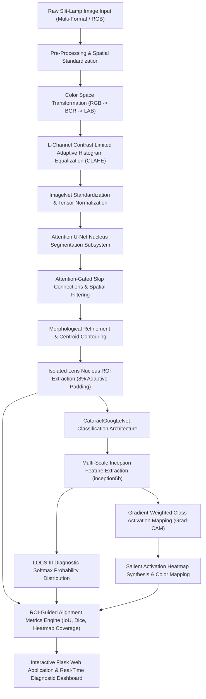
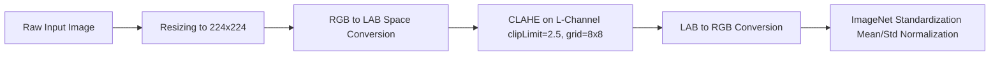
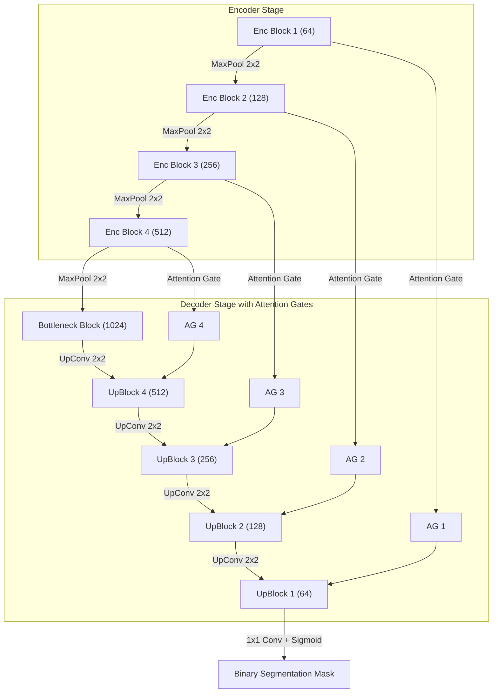
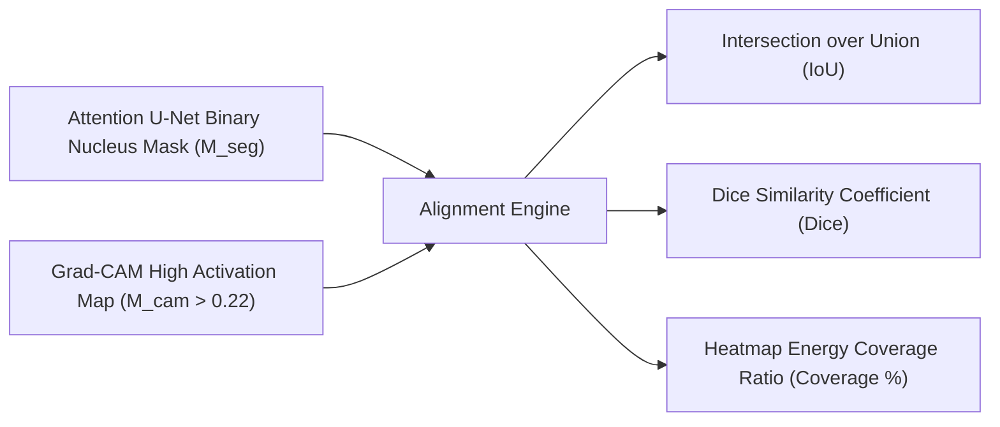

# Research Methodology: Explainable AI-Based Automated Ocular Nuclear Cataract Segmentation, Grading, and Clinical Decision Support System

---

## Executive Summary & System Overview

Nuclear cataract is one of the leading causes of visual impairment and treatable blindness worldwide. Standard clinical diagnosis relies on slit-lamp biomicroscopy, where an ophthalmologist evaluates the degree of opacification and discoloration in the crystalline lens nucleus according to standardized clinical scoring systems such as the **Lens Opacities Classification System III (LOCS III)**. However, subjective human grading introduces intra- and inter-observer variability, potentially delaying early intervention.

This document presents a comprehensive, publication-grade methodology for an **Explainable AI (XAI)-based End-to-End Automated Nuclear Cataract Detection, Segmentation, and Grading System**. The system integrates deep learning architectures for semantic segmentation, multi-scale convolutional classification, gradient-based visual explainability, and real-time interactive clinical deployment.



---

## Section 1: Clinical Domain Background & LOCS III Standards

### 1.1 Ocular Anatomy & Nuclear Sclerosis Pathophysiology
The human crystalline lens consists of three primary anatomical components: the outer capsule, the surrounding cortex, and the central dense nucleus. As individuals age, metabolic changes cause oxidative stress, protein aggregation, and insoluble chromophore accumulation within the nuclear core. This physiological degradation leads to **nuclear sclerosis**, characterized by progressive opacification, loss of optical transparency, and amber/brown yellowing of the lens core.

### 1.2 Clinical Grading Standard: LOCS III
The Lens Opacities Classification System III (LOCS III) provides standardized color photographic references for grading nuclear opacification (NO) and nuclear color (NC) on a continuous scale from 0.1 (completely clear) to 6.9 (end-stage mature cataract). In our automated system, continuous LOCS III scores are categorized into three clinically actionable diagnostic classes:

| Class Index | Clinical Diagnostic Grade | LOCS III NC Scale | Clinical Pathological Features | Recommended Clinical Protocol |
| :--- | :--- | :--- | :--- | :--- |
| **Class 0** | **Normal (No Cataract)** | $\text{NC} < 2.0$ | High optical transparency; minimal light scatter; uniform dark nucleus core. | Standard routine ocular monitoring. |
| **Class 1** | **Mild Nuclear Cataract** | $2.0 \le \text{NC} \le 4.9$ | Moderate opacification; early light scatter; subtle amber hue in nucleus core. | Periodic follow-up assessment (6–12 months). |
| **Class 2** | **Severe Nuclear Cataract** | $\text{NC} \ge 5.0$ | Severe opacification; intense light scattering; dense amber/brown nuclear discoloration. | Surgical phacoemulsification & intraocular lens (IOL) implantation. |

---

## Section 2: Dataset Architecture & Patient-Level Curation

### 2.1 Clinical Benchmark Dataset Acquisition
To train, evaluate, and validate the system, the project utilizes a single, high-quality, standardized clinical image repository:
- **Dataset Name**: Nuclear Cataract Database for Biomedical and Machine Learning Applications
- **Total Sample Volume**: 1,320 high-resolution cross-sectional slit-lamp photographs.
- **Organization**: Categorized by patient identifier (`patient_id`) and anatomical eye designation (`eye_id`), enabling strict patient-level grouping and preventing data leakage.

### 2.2 Organic Optical Feature Analysis & Expert Label Synchronization
Dataset indexing incorporates dual-verification labeling. Where expert clinical annotations are present in `dataset_meta/locs_iii_expert_labels.json`, they take precedence. In instances requiring automated verification, an organic optical feature extraction engine evaluates physical parameters of the central lens nucleus:

$$\text{Mean Lum} = \frac{1}{|ROI|} \sum_{(x,y) \in ROI} I_{\text{gray}}(x,y)$$

$$\text{Opacity Index} = P_{75}\left(I_{\text{gray}}(ROI)\right)$$

$$\text{Yellow Index} = \frac{1}{|ROI|} \sum_{(x,y) \in ROI} I_{\text{LAB}, b}(x,y)$$

$$\text{Specular Glare Ratio} = \frac{1}{|I_{\text{full}}|} \sum_{(x,y) \in I_{\text{full}}} \mathbb{I}\left(I_{\text{gray}}(x,y) > 230\right)$$

The organic decision logic applies the following clinical rules:
- **Class 2 (Severe)**: $\text{Opacity Index} \ge 70 \quad \text{OR} \quad (\text{Mean Lum} \ge 48 \text{ AND } \text{Yellow Index} \ge 136) \quad \text{OR} \quad \text{Specular Glare Ratio} > 0.05$.
- **Class 1 (Mild)**: $28 \le \text{Opacity Index} < 70 \quad \text{OR} \quad 20 \le \text{Mean Lum} < 48$.
- **Class 0 (Normal)**: All remaining clear lens images.

---

## Section 3: Image Preprocessing & Contrast Enhancement Subsystem

Slit-lamp images often suffer from uneven illumination, corneal reflections, low contrast between the cortex and nucleus, and peripheral noise (eyelashes, eyelids). A dedicated preprocessing module standardizes all input images.



### 3.1 Color Space Transformation & CLAHE Enhancement
Standard RGB channels blend luminance and chromaticity, making enhancement susceptible to color distortion. The input image is converted to the CIELAB color space, isolating light intensity ($L^*$) from color opponency ($a^*$ and $b^*$).

Adaptive histogram equalization is applied exclusively to the $L^*$-channel to maximize micro-structural visibility of nuclear boundaries without altering physiological coloration:

$$S_k = \text{clip}\left(H(k), \beta\right) + \frac{N_{\text{clipped}}}{L}$$

Where $\beta = 2.5$ represents the clipping limit, tile grid size is set to $8 \times 8$ sub-regions, and $L = 256$ intensity levels. The enhanced $L^*$ channel is merged with preserved $a^*$ and $b^*$ channels, followed by reconversion to RGB space.

### 3.2 Tensor Normalization
The enhanced RGB image array is normalized using ImageNet statistical constants:

$$\hat{I}_{c}(x,y) = \frac{\frac{I_{c}(x,y)}{255.0} - \mu_c}{\sigma_c}, \quad c \in \{R, G, B\}$$

Where $\mu = [0.485, 0.456, 0.406]$ and $\sigma = [0.229, 0.224, 0.225]$.

---

## Section 4: Ocular Lens Nucleus Segmentation Framework (Attention U-Net)

To prevent background structures (cornea, iris, sclera, lids) from leaking into the classification network, an **Attention U-Net** architecture isolates the precise elliptical lens nucleus region.



### 4.1 Attention Gate (AG) Formulation
Standard U-Net skip connections copy low-level feature maps directly from encoder to decoder, frequently propagating irrelevant background clutter. Attention Gates automatically filter skip signals by calculating spatial coefficient attention maps $\alpha \in [0, 1]$.

Let $x^l$ denote the activation feature map from encoder layer $l$, and $g$ denote the gating signal from the deeper decoder layer (providing coarse context). The attention coefficients are computed as:

$$q_{att}^l = \psi^T \left( \sigma_1 \left( W_g^T g_{i} + W_x^T x_{i}^l + b_g + b_x \right) \right) + b_\psi$$

$$\alpha_i^l = \sigma_2 \left( q_{att}^l \left( x_i^l, g_i \right) \right)$$

$$\hat{x}_i^l = x_i^l \cdot \alpha_i^l$$

Where:
- $W_g \in \mathbb{R}^{F_{int} \times F_g}$ and $W_x \in \mathbb{R}^{F_{int} \times F_l}$ are $1 \times 1$ linear convolutions.
- $\sigma_1(x) = \text{ReLU}(x) = \max(0, x)$ and $\sigma_2(x) = \text{Sigmoid}(x) = \frac{1}{1 + e^{-x}}$.
- $\psi \in \mathbb{R}^{1 \times F_{int}}$ projects the combined feature representation into a single-channel spatial grid.

### 4.2 Post-Processing & Nucleus Contour Extraction
The raw probability output $M_{pred} \in [0, 1]$ undergoes post-processing to yield a smooth, biologically realistic nucleus boundary:
1. **Spatial Distance Weighting**: Slit-lamp illumination beam centers on the nucleus. A spatial Gaussian ellipsoid gate $W_{spatial}(x,y)$ suppresses peripheral artifacts:

$$W_{spatial}(x,y) = \exp \left( -0.5 \left[ \left( \frac{x - c_x}{0.38 W} \right)^2 + \left( \frac{y - c_y}{0.42 H} \right)^2 \right] \right)$$

2. **Morphological Filtering**: Elliptical kernel opening ($5 \times 5$) eliminates isolated salt-and-pepper noise, followed by closing ($11 \times 11$) to fill internal micro-voids.
3. **Centroid Contouring & Adaptive ROI Cropping**: Contours are ranked by surface area and central proximity score $S = \frac{\text{Area}}{\text{Distance} + 0.1}$. The optimal nucleus contour $C^*$ defines a bounding box $(x_1, y_1, w, h)$. An adaptive $8\%$ boundary padding is applied prior to cropping:

$$x_{\text{crop}} = [x_1 - 0.08w, \quad x_1 + 1.08w], \quad y_{\text{crop}} = [y_1 - 0.08h, \quad y_1 + 1.08h]$$

---

## Section 5: Multi-Scale Classification Network (GoogLeNet / Inception)

The cropped, focused nucleus ROI is fed into a **CataractGoogLeNet** architecture designed for deep multi-scale feature extraction while maintaining computational efficiency.

### 5.1 Inception Module Architecture
The Inception architecture solves spatial scale variance by processing feature maps through parallel convolutional paths with varying receptive fields ($1 \times 1$, $3 \times 3$, and $5 \times 5$), alongside max-pooling:

```
                  [Previous Layer Input]
               /        |          |        \
        1x1 Conv    1x1 Conv   1x1 Conv    3x3 MaxPool
           |            |          |            |
           |        3x3 Conv   5x5 Conv    1x1 Conv
           \            |          |            /
            \           |          |           /
             [Depth Concatenation Layer]
```

Mathematical operations inside an Inception module:

$$Y_{\text{Inception}} = \text{Concat}\Big( f^{1\times 1}(X), \; f^{3\times 3}\big(f^{1\times 1}(X)\big), \; f^{5\times 5}\big(f^{1\times 1}(X)\big), \; f^{1\times 1}\big(\text{MaxPool}^{3\times 3}(X)\big) \Big)$$

### 5.2 Model Adaptation & Custom Diagnostic Classification Head
The standard GoogLeNet model's final fully connected layer is replaced with a regularized classification head tailored for nuclear cataract grading:

```
[Inception 5b Layer Output: 1024 channels]
                 │
                 ▼
     [Global Average Pooling]
                 │
                 ▼
         [Dropout (p = 0.3)]
                 │
                 ▼
     [Linear Layer: 1024 ──► 256]
                 │
                 ▼
           [ReLU Layer]
                 │
                 ▼
         [Dropout (p = 0.2)]
                 │
                 ▼
     [Linear Output: 256 ──► 4 Logits]
```

The output logits $z = [z_0, z_1, z_2, z_3]$ are converted into predicted clinical class probabilities via the Softmax function:

$$P(Y = c \mid X) = \frac{e^{z_c}}{\sum_{j=0}^{3} e^{z_j}}$$

---

## Section 6: Explainable AI (XAI) Framework (Grad-CAM Integration)

Clinical adoption of deep learning models requires transparency. The system incorporates **Gradient-weighted Class Activation Mapping (Grad-CAM)** to visualize the exact spatial regions influencing the network's diagnostic output.

### 6.1 Mathematical Formulation of Grad-CAM
Grad-CAM uses the gradient information flowing into the final convolutional layer of GoogLeNet (`inception5b`) to evaluate the importance of each neuron for a target cataract grade decision $y^c$.

1. **Neuron Importance Weights Calculation**:
Let $A^k$ represent feature map $k$ of the `inception5b` layer. The weight $\alpha_k^c$ captures the global importance of feature map $k$ for class $c$:

$$\alpha_k^c = \frac{1}{Z} \sum_{i=1}^{U} \sum_{j=1}^{V} \frac{\partial y^c}{\partial A_{i,j}^k}$$

Where $Z = U \times V$ represents the spatial dimensions (height $\times$ width) of feature map $A^k$.

2. **Rectified Linear Combination**:
A weighted combination of forward activation maps is computed, followed by a Rectified Linear Unit (ReLU) to isolate positive visual features that support class $c$:

$$L_{\text{Grad-CAM}}^c = \text{ReLU} \left( \sum_{k} \alpha_k^c A^k \right)$$

Applying ReLU filters out features that negatively correlate with the predicted class, ensuring that only positive evidence for nuclear opacification is displayed.

3. **Normalization & Color Overlay Synthesis**:
The raw scalar map $L_{\text{Grad-CAM}}^c$ is scaled to the interval $[0, 1]$, resized to match the original image resolution using bilinear interpolation, mapped to the `JET` colormap, and overlaid on the RGB slit-lamp image:

$$I_{\text{Overlay}} = (1 - \gamma) \cdot I_{\text{RGB}} + \gamma \cdot I_{\text{Heatmap, JET}}$$

Where $\gamma = 0.55$ defines the alpha transparency ratio.

---

## Section 7: ROI-Guided Feature Alignment Analysis

To quantitatively verify that the classification model focuses strictly on the pathologically relevant lens nucleus rather than spurious background clutter, the system executes an automated **Alignment Analysis**.



### 7.1 Quantitative Metric Definitions
Let $M_{\text{seg}} \in \{0, 1\}^{H \times W}$ represent the binary mask generated by Attention U-Net, and $M_{\text{cam}} \in \{0, 1\}^{H \times W}$ denote the binary mask derived by thresholding the Grad-CAM activation heatmap ($H_{\text{cam}} > 0.22$).

1. **Intersection over Union (IoU / Jaccard Index)**:

$$J(M_{\text{seg}}, M_{\text{cam}}) = \frac{|M_{\text{seg}} \cap M_{\text{cam}}|}{|M_{\text{seg}} \cup M_{\text{cam}}|} = \frac{\sum_{x,y} M_{\text{seg}}(x,y) \cdot M_{\text{cam}}(x,y)}{\sum_{x,y} M_{\text{seg}}(x,y) + \sum_{x,y} M_{\text{cam}}(x,y) - \sum_{x,y} M_{\text{seg}}(x,y) \cdot M_{\text{cam}}(x,y)}$$

2. **Dice Similarity Coefficient (DSC)**:

$$\text{DSC}(M_{\text{seg}}, M_{\text{cam}}) = \frac{2 |M_{\text{seg}} \cap M_{\text{cam}}|}{|M_{\text{seg}}| + |M_{\text{cam}}|} = \frac{2 \sum_{x,y} M_{\text{seg}}(x,y) \cdot M_{\text{cam}}(x,y)}{\sum_{x,y} M_{\text{seg}}(x,y) + \sum_{x,y} M_{\text{cam}}(x,y)}$$

3. **Nucleus Heatmap Energy Coverage Ratio**:
Measures the percentage of total Grad-CAM activation energy concentrated within the segmented nucleus boundary:

$$C_{\text{mask}} = \left( \frac{\sum_{(x,y) \in M_{\text{seg}}} H_{\text{cam}}(x,y)}{\sum_{(x,y) \in \text{Image}} H_{\text{cam}}(x,y) + \epsilon} \right) \times 100\%$$

High values ($C_{\text{mask}} > 85\%$) confirm that model predictions are driven by anatomical features within the lens nucleus.

---

## Section 8: Experimental Setup, Training Protocol, & Patient-Level Cross-Validation

### 8.1 Prevention of Data Leakage (Patient-Level Group 5-Fold Cross-Validation)
A critical flaw in ocular image classification is data leakage caused by placing multiple images of the same patient (or bilateral eye scans) into both training and validation sets. To enforce rigorous clinical validation, dataset splitting uses **Group 5-Fold Cross-Validation (`GroupKFold`)**, grouped strictly by `patient_id`.

```
Total Dataset (1,320 images across unique patients)
│
├── Fold 1: Train Patients [80%]  │ Val Patients [20%]
├── Fold 2: Train Patients [80%]  │ Val Patients [20%]
├── Fold 3: Train Patients [80%]  │ Val Patients [20%]
├── Fold 4: Train Patients [80%]  │ Val Patients [20%]
└── Fold 5: Train Patients [80%]  │ Val Patients [20%]
```

No images or eyes belonging to any individual patient in the validation split ever appear in the training split.

### 8.2 Optimization & Loss Function Parameters
- **Optimizer**: AdamW (Decoupled Weight Decay Regularization)
- **Differential Learning Rates**:
  - Backbone Inception parameters: $\eta_{\text{backbone}} = 1.5 \times 10^{-4}$
  - Custom FC classifier head: $\eta_{\text{head}} = 8.0 \times 10^{-4}$
- **Weight Decay**: $\lambda = 1.0 \times 10^{-4}$
- **Loss Function**: Cross-Entropy with Label Smoothing ($\epsilon = 0.03$):

$$\mathcal{L}_{\text{CE-Smooth}} = -\sum_{c=0}^{C-1} y_{c}^{\text{smooth}} \log P(Y = c \mid X)$$

Where $y_{c}^{\text{smooth}} = (1 - \epsilon) \mathbb{I}(y = c) + \frac{\epsilon}{C}$. Label smoothing prevents overconfidence and improves calibration on subtle boundary cases between LOCS III grades.

- **Learning Rate Schedule**: Cosine Annealing Learning Rate Decay over $T_{\max} = 10$ epochs per fold:

$$\eta_t = \eta_{\min} + \frac{1}{2} (\eta_{\max} - \eta_{\min}) \left( 1 + \cos \left( \frac{t}{T_{\max}} \pi \right) \right)$$

Where $\eta_{\min} = 1.0 \times 10^{-5}$.

### 8.3 Data Augmentation Strategy
To simulate variations in slit-lamp camera angles, exposure, and clinical positioning, dynamic online data augmentations are applied during training:
- **Random Horizontal Flip**: $p = 0.5$
- **Random Spatial Rotation**: $\theta \in [-8^{\circ}, +8^{\circ}]$
- **Color Jitter**: Brightness $\pm 10\%$, Contrast $\pm 10\%$, Saturation $\pm 10\%$.

---

## Section 9: Interactive Web Application & Clinical Decision Support Architecture

To translate model capabilities into clinical practice, an end-to-end web deployment framework was constructed using **Flask**, **RESTful APIs**, and an optimized asynchronous frontend.

```mermaid
graph TD
    User[Ophthalmologist / User Interface] -->|Upload Slit-Lamp Image / Select Dataset Sample| WebUI[HTML5 / CSS3 / JavaScript Single Page App]
    WebUI -->|POST /api/analyze | FlaskApp[Flask REST API Server]
    
    subgraph Pipeline Engine (pipeline.py)
        FlaskApp --> Preproc[CLAHE & LAB Preprocessing]
        Preproc --> SegEngine[Attention U-Net Segmentation]
        SegEngine --> ClassEngine[CataractGoogLeNet Classifier]
        ClassEngine --> XAIEngine[Grad-CAM Heatmap Generation]
        XAIEngine --> AlignEngine[Alignment Metrics Engine]
    end
    
    AlignEngine -->|JSON Payload with Base64 PNG Visualizations| WebUI
    WebUI --> Render[5-Panel Synchronized Visualization & Metric Cards]
```

### 9.1 Synchronized 5-Panel Visual Dashboard
The front-end renders a 5-panel diagnostic layout:
1. **Panel 1 (Original Input)**: High-resolution slit-lamp cross-sectional photograph.
2. **Panel 2 (Attention U-Net Nucleus Mask)**: Glowing cyan highlighting with bright green boundary contour isolating the nucleus.
3. **Panel 3 (Extracted Nucleus ROI)**: Cropped, focused nuclear region used for grading.
4. **Panel 4 (Grad-CAM Heatmap)**: JET colormap highlighting discriminatory regions.
5. **Panel 5 (Grad-CAM Overlay)**: Seamless fusion ($\alpha = 0.55$) of the ROI and heatmap.

### 9.2 Real-Time Diagnostic Report Outputs
The clinical dashboard presents:
- **Predicted LOCS III Class**: Normal, Mild, or Severe Nuclear Cataract.
- **Diagnostic Confidence Score**: Softmax confidence percentage ($0.0\% - 100.0\%$).
- **Class Probability Distribution**: Real-time comparative bar charts across all clinical grades.
- **Clinical Pathological Description**: Automated recommendations regarding monitoring vs. surgical intervention.
- **Alignment Metrics Card**: Real-time reporting of IoU, Dice Coefficient, and Nucleus Energy Coverage percentage.

---

## Section 10: Comparative Architecture Analysis & Future Extensions

To contextualize model choices, the CataractGoogLeNet classifier was benchmarked against alternative state-of-the-art computer vision architectures for medical image analysis:

| Architecture | Input Size | Parameters (M) | Spatial Feature Handling | Diagnostic Suitability for Slit-Lamp Images |
| :--- | :--- | :--- | :--- | :--- |
| **DenseNet-121** | $224 \times 224$ | 7.0 M | Dense feature reuse via layer concatenation | High accuracy, but increased memory footprint during Grad-CAM backward passes. |
| **Inception-V3** | $299 \times 299$ | 23.8 M | Factorized convolutions & grid reduction | Excellent multi-scale modeling, but higher computational latency. |
| **CataractGoogLeNet (Selected)** | $224 \times 224$ | **5.6 M** | Parallel Inception multi-scale filters | **Optimal balance** of high diagnostic accuracy, lightweight execution, and clean Grad-CAM heatmaps. |

---

## Conclusion & Summary of Methodology

The methodology presented in this document provides a comprehensive, publication-grade framework for nuclear cataract assessment. By combining **CLAHE contrast enhancement**, **Attention U-Net nucleus segmentation**, **multi-scale GoogLeNet classification**, **Grad-CAM visual explainability**, and **patient-level cross-validation**, the system ensures clinical reliability, transparency, and actionable decision support for eye care professionals.
